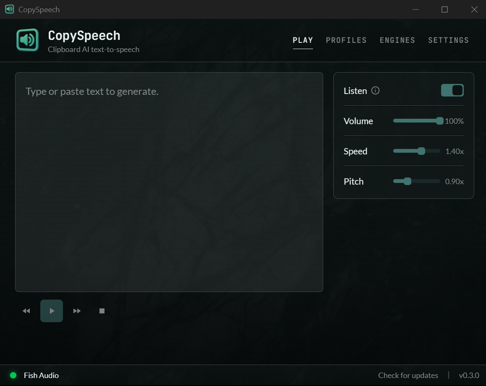

<div align="center">


# CopySpeech

**Copy twice. Hear it.**

CopySpeech reads your clipboard aloud. Copy the same text twice within 1.5 s, and an AI voice speaks it, with a HUD and word-level captions.

[](https://github.com/ilyaizen/CopySpeech/releases)
[](LICENSE)

Windows · macOS (Intel) · Linux (x86_64)

[Download](https://github.com/ilyaizen/CopySpeech/releases) · [Changelog](CHANGELOG.md) · [Contributing](docs/CONTRIBUTING.md) · [Issues](https://github.com/ilyaizen/CopySpeech/issues)

</div>



## Why

Most read-aloud tools need a browser tab, a cloud account, or a hotkey and a settings detour. CopySpeech watches the clipboard. Copy twice, and it speaks. Local engines run offline with no API key. Cloud engines stay available when you want them.

## Features

- **Double-copy trigger.** No hotkey needed. The tray and the Play page work too.
- **16 engine backends.**
  - Local: Kokoro (default), Piper, Kitten, Qwen3-TTS, Pocket, and any CLI TTS tool.
  - Cloud: OpenAI, ElevenLabs, Cartesia, Fish Audio, xAI, Mistral, Google, Microsoft Azure, Edge (keyless), and any HTTP endpoint.
- **One-click local installs.** Kokoro installs from onboarding. Installs stream progress and support optional CUDA.
- **Live captions.** Words highlight in sync with the audio on the Play page, the HUD, and the browser companion. Captions need an engine that reports timings.
- **Streaming playback.** Local engines start speaking after the first audio window.
- **Speed 0.25×–4×, pitch, and volume.** Voice profiles store each combination per engine.
- **Duck other apps (Windows).** Other apps get quieter while CopySpeech speaks.
- **Text cleanup.** Strips markdown, expands URLs, and normalizes Unicode. It handles non-Latin scripts without damage.
- **Browser companion.** Reads your selection through the app. Chrome, Edge, and Firefox are supported. The page highlights the passage as it plays.
- **Control server.** A local HTTP API for scripts and tools. See [Control server](#control-server).
- **Interface.** 9 languages, right-to-left layouts, tray, dark and light themes, and an auto-updater.

## Experimental features

Experimental features are alpha. They can change or break between releases.

The **Experimental Features (Alpha)** switch lives in **Settings → Advanced**. It gates these features:

| Feature            | What it does                                            |
| ------------------ | ------------------------------------------------------- |
| Global hotkey      | Starts a reading from any app                           |
| Audio effects      | Walkie-talkie, 8-bit, and Cyberpunk effects per profile |
| Auto-save profiles | Writes profile edits without a Save step                |
| History            | Keeps a log of past readings                            |
| Post-processing    | Rewrites text with an LLM before speaking               |
| HUD overlay        | Floating window with a live waveform and captions       |

When the switch is off, these features pause. Their settings and saved readings stay on disk.

Plugin-level experiments:

- **DSH partial auto-read** (0.1.1). Reads only the first or last paragraphs of each automatic reply.

Not yet verified live, per the plugin notes:

- Hermes follow-scroll playback.
- The explicit-Save settings page in the Hermes plugin.

## Install

Get a build from [Releases](https://github.com/ilyaizen/CopySpeech/releases). Replace `<version>` with the release number. The latest is 0.3.0.

| Platform          | Asset                                                                    |
| ----------------- | ------------------------------------------------------------------------ |
| Windows           | `CopySpeech_<version>_x64-setup.exe` (`.msi` also available)             |
| macOS (Intel)     | `CopySpeech_<version>_x64.dmg` (Apple Silicon runs it through Rosetta 2) |
| Linux             | `.AppImage`, `.deb`, or `.rpm`                                           |
| Browser companion | `CopySpeech-Companion-<version>.zip`                                     |

Onboarding asks you to pick an engine and a voice on first launch. Kokoro is the default.

**Linux note.** Wayland blocks global hotkeys. Use double-copy, the tray, or a compositor keybind that calls the [control server](#control-server).

**Browser companion (Chrome).**

1. Start the desktop app first.
2. Extract the companion zip.
3. Open `chrome://extensions`, turn on **Developer mode**, and choose **Load unpacked** on the extracted folder.
4. Grant per-site access in the extension settings.

On Windows, installed builds register the Chrome host at launch. Edge, Firefox, Linux, and macOS need manual setup.

## Plugins

### Hermes Desktop plugin (`copyspeech-hermes`)

Reads each new completed Hermes reply aloud through the running app. It can highlight spoken words and follow playback.

1. Create a junction so Hermes loads the repo file in place:

   ```powershell
   New-Item -ItemType Junction -Path "$env:LOCALAPPDATA\hermes\desktop-plugins\copyspeech-hermes" -Target "<repo>\copyspeech-hermes"
   ```

2. Open **Settings → Plugins → CopySpeech** and turn on **Read new replies aloud**.
3. Turn off Hermes's built-in **Read replies aloud**. If both run, each reply plays twice.

Changes apply when you press **Save**. Edits to `plugin.js` reload in the app.

### DSH plugin (`copyspeech-dsh`)

DSH is the DeepSeek Harness. This plugin adds a sidebar panel, a speaker action on each reply, a selection pill, and a playback bar with pause, ±5 s seek, and stop.

1. Ask the DSH plugin manager to run `install_bundle` with the absolute path to `copyspeech-dsh/`.
2. Open the CopySpeech panel. The status line reads **CopySpeech is running.**
3. Send a message and click the speaker in the reply's action row.

The plugin needs the control server on `127.0.0.1:43117`. Full details are in [copyspeech-dsh/README.md](copyspeech-dsh/README.md).

### Agent voice

The Pi extension and the Claude Code hook speak final assistant replies. See [docs/agent-voice.md](docs/agent-voice.md).

### Control server

A local HTTP API on `127.0.0.1:43117`:

| Route                         | Purpose                                     |
| ----------------------------- | ------------------------------------------- |
| `GET /health`                 | Check that the app runs                     |
| `GET /status`                 | Read the current caption                    |
| `POST /speak`                 | Speak text. Pass `wait` to block until done |
| `POST /pause`, `POST /resume` | Pause or resume one reading                 |
| `POST /seek`                  | Move one reading by a signed step           |
| `POST /stop`                  | Stop playback                               |

Details are in [docs/profile-engine-settings.md](docs/profile-engine-settings.md).

## Development

```bash
bun install
bun run tauri dev
```

| Command                      | Purpose                                                       |
| ---------------------------- | ------------------------------------------------------------- |
| `bun run dev`                | Frontend only, on port 5173                                   |
| `bun run check`              | Svelte and TypeScript checks, then lint                       |
| `bun run test`               | Frontend tests (Vitest)                                       |
| `bun run format`             | Format the repo                                               |
| `bun run tauri build`        | Production build                                              |
| `cd src-tauri && cargo test` | Rust tests                                                    |
| `bun run bump`               | Patch version bump (`bump:minor` and `bump:major` also exist) |

| Layer    | Stack                                           |
| -------- | ----------------------------------------------- |
| Backend  | Rust, Tauri 2                                   |
| Frontend | Svelte 5, SvelteKit, TypeScript, Tailwind CSS 4 |
| Audio    | rodio, Web Audio (`OfflineAudioContext`)        |
| Tooling  | Bun, Vite+ (`vp`), shadcn-svelte                |
| i18n     | svelte-i18n, Crowdin                            |

Read [Understanding the Codebase](docs/CONTRIBUTING.md#understanding-the-codebase) before you change code. [docs/engines.md](docs/engines.md) explains how local engines connect.

## Roadmap

The next release targets low time-to-first-audio and a small VRAM and RAM footprint. The goal is local engines that run well on low-VRAM GPUs and CPU-only machines.

## Contributing

Read the [Contributing Guide](docs/CONTRIBUTING.md) for setup, style, and pull request steps.

## License

[MIT](LICENSE)
