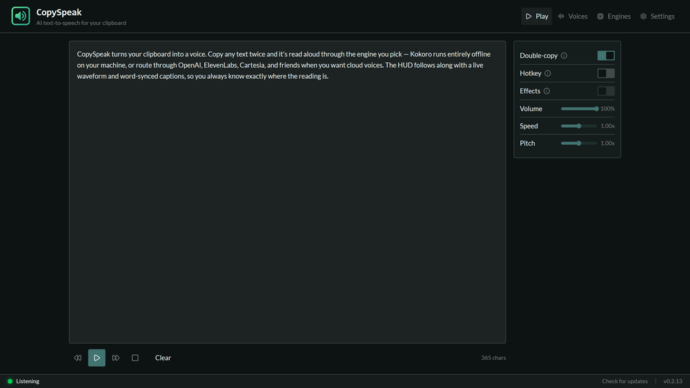

<div align="center">


# CopySpeak

**Your clipboard, read aloud.** Double-copy any text and an AI voice reads it back — with a floating HUD, live word-synced captions, and 12 TTS engines that run offline by default.

[Download](https://github.com/ilyaizen/CopySpeak/releases) · [Changelog](CHANGELOG.md) · [Issues](https://github.com/ilyaizen/CopySpeak/issues) · [Contributing](docs/CONTRIBUTING.md)

**Windows · macOS (Intel) · Linux (x86_64)**

</div>

---



## Why CopySpeak

Most read-aloud tools are browser extensions chained to a cloud API, or desktop apps that need a hotkey and a settings detour before anything speaks. CopySpeak watches your clipboard instead: copy any text twice, and it speaks — no window focus, no selection dance. Voices run locally by default (Kokoro installs in one click from onboarding, no API key), cloud engines are there when you want them, and the whole surface — triggers, voices, effects, captions, export — is configurable.

## Features

### Triggers & playback

- ✅ **Double-copy trigger** — copy the same text twice within 1.5 s to start a reading; no hotkey needed
- ✅ **Global hotkey & tray** — configurable shortcut, plus Speak Clipboard from the tray (localized to your language)
- ✅ **Play page** — paste text and speak, with full transport controls: rewind/forward ±5 s, play/pause (Space), stop (Escape — aborts in-flight synthesis immediately)
- ✅ **Streaming playback** — first audio starts after ~150 ms of buffering; local engines stream once warm, OpenAI streams on `gpt-4o-mini-tts`
- ✅ **Speed 0.25×–4×, pitch 0.5×–2×, volume** — with output device selection and MP3/OGG/FLAC export
- ✅ **Duck other apps** (Windows) — lowers or mutes other apps' audio while CopySpeak speaks, restores them after, per app

### Engines & voices

- ✅ **12 TTS engines** — offline: **Kokoro** (default), Piper, Kitten, Qwen3-TTS, Pocket, and any CLI TTS tool; cloud: OpenAI, ElevenLabs, Cartesia, Google, Microsoft Azure, and generic HTTP endpoints
- ✅ **One-click local engine installs** — streamed progress, optional CUDA GPU support, and live install/runtime status (Installed badge, CPU vs GPU per run)
- ✅ **Idle shutdown** — local engine daemons exit after inactivity (default 10 min) and free their RAM/VRAM
- ✅ **Model picker** — model fields for OpenAI, ElevenLabs, Cartesia, and Google are lists built from each vendor's documented models
- ✅ **Voice profiles** — named profiles bundling engine, voice, speed, pitch, and effects

### Captions & effects

- ✅ **HUD overlay** — floating heads-up display with a real-time waveform
- ✅ **Live captions** — word-level highlighting synced to the audio clock, on the Play page, the HUD, and the browser companion
- ✅ **Audio effects** — walkie-talkie, 8-bit, and Cyberpunk (56k modem handshake intro, glitch-stuttered words, ring-modulated tone), built on `OfflineAudioContext` post-processing

### Text pipeline

- ✅ **Sanitization** — markdown stripping, URL expansion, and unicode normalization, careful with non-English scripts (no Cyrillic lookalike swaps, zero-width joiners preserved, sentence-aware splitting for Hindi/Arabic/Urdu/Armenian/Amharic/Burmese/Khmer)
- ✅ **LLM post-processing** — optional AI rewrite pass with a provider registry (Groq, OpenAI, Z.AI, OpenRouter, Ollama, Cerebras, or any OpenAI-compatible endpoint), live model lists, minimum-length and on-request gating

### Integrations

- ✅ **Browser companion** (Chrome/Edge) — read your selection or hovered paragraphs through the app; the extension highlights the passage on the page while it's read, with ±5 s skip on its pill
- ✅ **Control server** — local HTTP API (`/health`, `/speak` with optional blocking wait) for scripts and external tools; see [profile & engine settings](docs/profile-engine-settings.md)
- ✅ **Pi & Claude Code extensions** — speak AI assistant responses through CopySpeak

### System

- ✅ **History** — persistent generation history with playback, batch management, and export; switch it off and readings stay out of the log (a small recent-clips cache still skips re-synthesis)
- ✅ **9 interface languages** — English, Spanish, Hebrew, Arabic, German, French, Hindi, Russian, Simplified Chinese; Hebrew and Arabic mirror right-to-left, and the tray follows the app language
- ✅ **Auto-updater** — checks GitHub Releases in the background; also **system tray**, **dark/light themes**, and **audio save mode**

## Install

Grab a build from [Releases](https://github.com/ilyaizen/CopySpeak/releases). Asset names per platform (v0.2.13 shown):

| Platform          | Asset                                                                                            |
| ----------------- | ------------------------------------------------------------------------------------------------ |
| Windows           | `CopySpeak_0.2.13_x64-setup.exe` (`.msi` also available)                                         |
| macOS (Intel)     | `CopySpeak_0.2.13_x64.dmg`                                                                       |
| Linux             | `CopySpeak_0.2.13_amd64.AppImage`, `CopySpeak_0.2.13_amd64.deb`, `CopySpeak-0.2.13-1.x86_64.rpm` |
| Browser companion | `CopySpeak-Companion-0.2.13.zip`                                                                 |

### Windows

1. Run the installer.
2. On first launch, onboarding walks you through picking an engine and voice — Kokoro is the recommended default and installs right there.
3. Updates: the app checks GitHub Releases automatically (or via **Check for updates** in the footer).

### macOS (Intel)

1. Open the `.dmg` and drag CopySpeak to Applications. (Apple Silicon Macs run the x86_64 build through Rosetta 2.)
2. On first launch, onboarding walks you through picking an engine and voice.
3. Updates: the built-in auto-updater handles new releases.

### Linux (x86_64)

Tested on Omarchy (Arch, Wayland):

```bash
# AppImage
chmod +x CopySpeak_0.2.13_amd64.AppImage
./CopySpeak_0.2.13_amd64.AppImage

# Debian / Ubuntu
sudo apt install ./CopySpeak_0.2.13_amd64.deb

# Fedora / openSUSE
sudo dnf install ./CopySpeak-0.2.13-1.x86_64.rpm
```

On Wayland compositors the HUD runs through XWayland and global hotkeys are protocol-impossible — trigger readings by double-copy, the tray, or a compositor keybind that POSTs to the local [control server](docs/profile-engine-settings.md).

### Browser companion (Chrome / Edge)

1. Install and start the desktop app first — the extension drives it.
2. Download `CopySpeak-Companion-0.2.13.zip` from the same release and extract it.
3. Open `chrome://extensions`, enable **Developer mode**, click **Load unpacked**, and select the extracted `dist` folder.
4. Open the extension's settings to grant per-site access, then select text and double-copy (or use the extension's toolbar button) to read it through the app — the extension highlights the passage as it's spoken.

## Development

```bash
bun install
bun run tauri dev
```

The frontend is SvelteKit (Svelte 5); the backend is Rust under `src-tauri`. See [Understanding the Codebase](docs/CONTRIBUTING.md#understanding-the-codebase) in the contributing guide, and [docs/engines.md](docs/engines.md) for how local TTS engines are wired.

## Commands

```bash
# Development
bun run tauri dev           # Full app with hot-reload
bun run dev                 # Frontend only (port 5173)

# Build
bun run tauri build         # Production build

bun run check               # TypeScript/Svelte type checking
bun run check:watch         # Watch mode for type checking

# Testing (Frontend)
bun run test                # Run all frontend tests (vitest)
bun run test <name>         # Run single frontend test
bun run test:watch          # Watch mode

# Testing (Rust)
cd src-tauri && cargo test             # Run all Rust tests
cd src-tauri && cargo test <name>      # Run single Rust test
cd src-tauri && cargo check            # Type check Rust
cd src-tauri && cargo clippy           # Lint Rust

# Formatting
bun format                   # Biome + Prettier hybrid format

# Version Bumping
bun run bump                # Patch version bump (0.0.x)
bun run bump:minor          # Minor version bump (0.x.0)
bun run bump:major          # Major version bump (x.0.0)
```

## Tech Stack

| Component       | Technology                               |
| --------------- | ---------------------------------------- |
| Platforms       | Windows, macOS (Intel), Linux (x86_64)   |
| Backend         | Rust (Tauri v2)                          |
| Frontend        | Svelte 5, SvelteKit, TypeScript, Vite    |
| Package Manager | Bun                                      |
| Audio           | rodio, Web Audio (`OfflineAudioContext`) |
| UI              | shadcn-svelte, Tailwind CSS v4           |
| i18n            | svelte-i18n, 9 locales, Crowdin          |

## Roadmap

**Next release** targets low-latency, interactive TTS on low-VRAM GPUs and CPU-only machines:

- Low time-to-first-audio (TTFA) for responsive playback
- Small VRAM and RAM footprint for local engines

## Changelog

See [CHANGELOG.md](./CHANGELOG.md) for recent changes.

## Contributing

We welcome contributions! Please see our [Contributing Guide](./docs/CONTRIBUTING.md) for details on how to get started, code style guidelines, and how to submit pull requests.

## License

[MIT](LICENSE)
